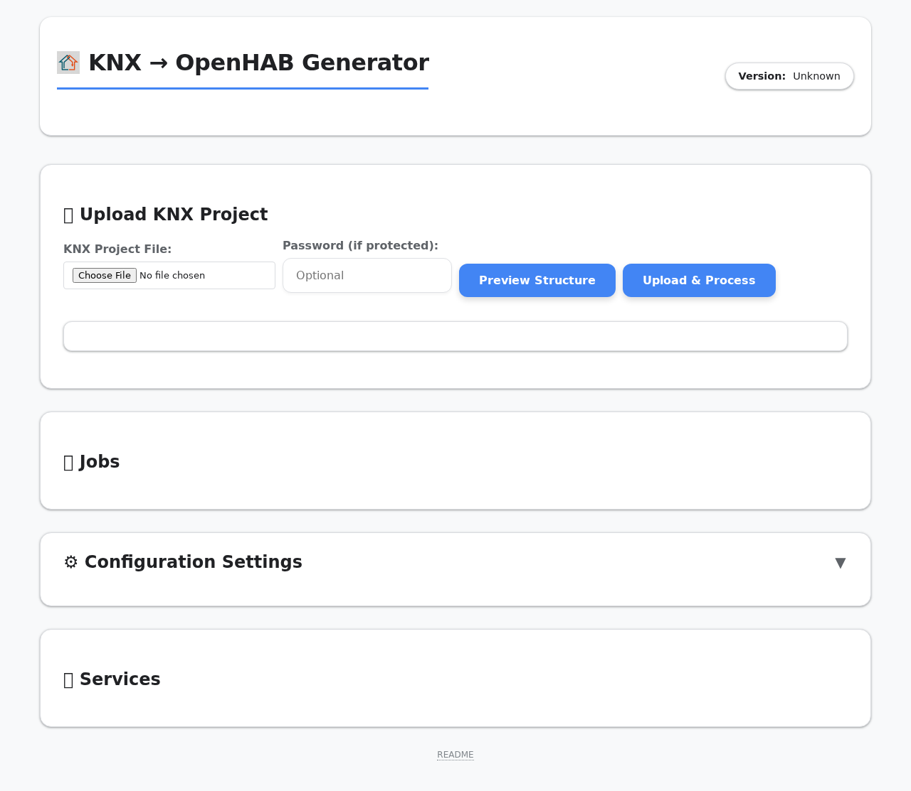
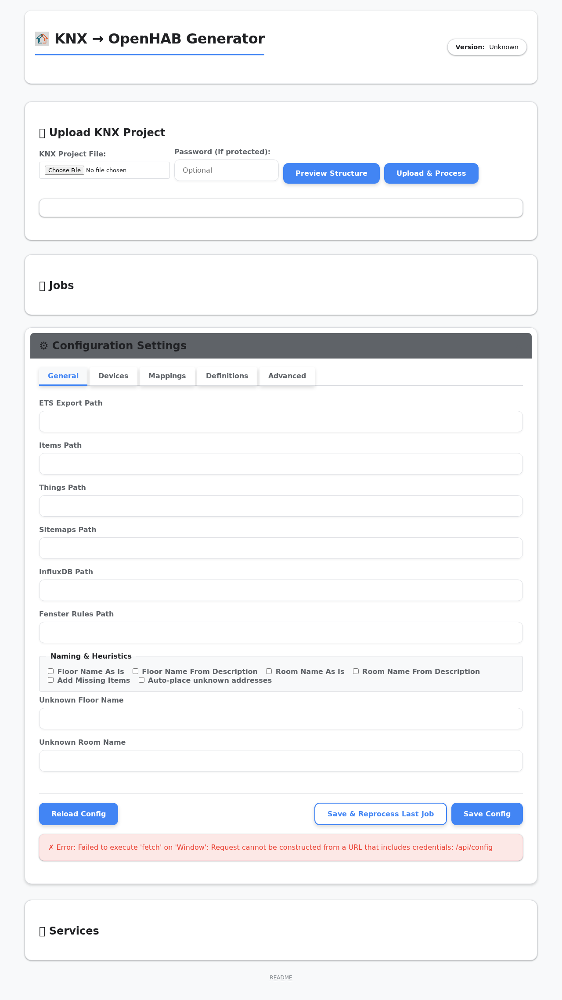

# KNX to OpenHAB Generator

A tool that generates complete [OpenHAB](https://www.openhab.org/) configurations (Items, Things, Sitemaps, Persistence) directly from ETS project exports (`.knxproj`) or JSON dumps.

Includes a **Web UI** for browser-based management and a **CLI** for automated workflows.

## Features

- **Automated Generation** — Creates Things, Items, Sitemaps, and Persistence rules in one step
- **openHAB 5.2 YAML** — Optionally combines Things, Items, semantic metadata, channels, and the Sitemap in one native, versioned YAML file
- **Smart Detection** — Identifies Dimmers, Rollershutters, Thermostats, and multi-address components by DPT analysis and naming conventions
- **Web Interface** — Drag-and-drop upload, live progress streaming (SSE), job history, diff viewer, deploy/rollback
- **Backup & Rollback** — Automatic tar.gz backup before each generation; rollback restores generated files and preserves manual OpenHAB configuration
- **Reports** — Unknown addresses, partial items, completeness checks (missing required channels)
- **Auto-Placement** — Optional: automatically create missing floors/rooms for unmatched addresses
- **Semantic Model** — Auto-tags items for OpenHAB's semantic model
- **HomeKit / Alexa** — Auto-generates metadata when enabled in ETS project comments
- **InfluxDB Support** — Auto-configure persistence via ETS description tags
- **Self-Update** — Check for and apply updates from GitHub directly in the UI
- **Service Management** — Restart OpenHAB from the Web UI

## Documentation

| Guide | For whom | What's in it |
|-------|----------|--------------|
| **[User Guide](docs/USER_GUIDE.md)** | End users | Configuration, ETS preparation, DPT mappings, troubleshooting |
| **[Production Guide](docs/PRODUCTION_GUIDE.md)** | Raspberry Pi admins | Installation, systemd, API reference, security |
| **[Developer Guide](docs/DEVELOPER_GUIDE.md)** | Contributors | Local setup, architecture, testing, coding conventions |
| **[Contributing](CONTRIBUTING.md)** | Contributors | Branch naming, commit style, PR checklist |

---

## Quick Start

### Option 1: One-Command Installer (Linux / Raspberry Pi)

Best for fresh installs of Raspberry Pi OS (Lite) or DietPi.

**Prereqs:** Linux with systemd, `sudo`, Git, curl, Python 3.11+, a working `python3-venv`, enough disk space, and network access to GitHub. The installer checks these before package changes. Python 3.11/3.12/3.13 are used in CI; `python3-tk` is only needed for the CLI file picker.

The top-level installer selects the latest published stable GitHub Release.

<!-- no-release-note -->
Until the first stable release is published, use this checkout-based setup on the target host:

```bash
git clone --branch dev https://github.com/diddip21/knx_to_openhab.git
cd knx_to_openhab
sudo apt-get update
sudo apt-get install -y rsync
sudo bash installer/setup.sh
```

The release installer installs `rsync` as a system dependency. A direct checkout setup does not install system packages and requires `rsync` beforehand.
<!-- /no-release-note -->

Once a stable release is published, the release installer is available with:

```bash
curl -sSL https://raw.githubusercontent.com/diddip21/knx_to_openhab/main/install.sh | bash
```

On a published release this will:
1. Install system dependencies (Python, git, etc.)
2. Clone the repository to `/opt/knx_to_openhab`
3. Set up the **knxohui** systemd service (Web UI on port 8085)
4. Configure permissions for self-updates

### Option 2: CLI (Any Platform)

```bash
git clone https://github.com/diddip21/knx_to_openhab.git
cd knx_to_openhab
pip install -r requirements.txt

python knxproject_to_openhab.py --file_path "MyHouse.knxproj"
```

For an existing JSON dump, add `--readDump`:

```bash
python knxproject_to_openhab.py --file_path "project.knxproj.json" --readDump
```

Output files are written to the `openhab/` directory by default. Paths and format are configured in `config.json`; an installed service stores generator settings in `/var/lib/knx_to_openhab/generator.json`.

### Option 3: Local Development

```bash
git clone https://github.com/diddip21/knx_to_openhab.git
cd knx_to_openhab

# Linux / macOS
chmod +x scripts/dev-setup.sh scripts/dev-run.sh
./scripts/dev-setup.sh
./scripts/dev-run.sh
```

```powershell
# Windows PowerShell
.\scripts\dev-setup.ps1
.\scripts\dev-run.ps1
```

The development server listens on `http://localhost:5000` and is separate from the production `knxohui.service` on port 8085. Install `requirements-dev.txt` in the virtual environment to run tests. See the [Developer Guide](docs/DEVELOPER_GUIDE.md) for setup details.

---

## Using the Web UI

1. **Open** `http://127.0.0.1:8085` on the device and use the Web UI password set during
   installation. The service listens on localhost by default. From another computer, create an
   SSH tunnel with `ssh -L 8085:127.0.0.1:8085 <user>@<device-ip>`, then open the same URL.
   When setup has no existing password to preserve, it generates a unique password and
   displays it once. Save it before continuing; no shared default password is shipped.
   Rotate it later with the secure helper in [`installer/README.md`](installer/README.md).
2. **Upload** your `.knxproj` export or JSON dump
3. **Preview** the building structure before processing
4. **Review** generated files, diffs, and reports
5. **Deploy** when satisfied (copies files to live OpenHAB directory)

### What Gets Generated

For each KNX project, the generator produces:

| File | Contents |
|------|----------|
| `yaml/knx.yaml` | Native openHAB 5.2 model containing Things, Items, links, metadata, and Sitemap (when `output_format` is `yaml`) |
| `knx.items` | Item definitions with types, icons, semantics, HomeKit/Alexa metadata |
| `knx.things` | Thing definitions with KNX bridge and channel mappings |
| `knx.sitemap` | Sitemap with floor/room hierarchy and labeled widgets |
| `influxdb.persist` | InfluxDB persistence rules for items tagged with `influx` |
| `fenster.rules` | Window-contact notification rule (text in both model formats) |

The three legacy model files are mutually exclusive with `yaml/knx.yaml`. Persistence remains textual because openHAB 5.2 does not expose persistence as a YAML top-level entity. See the [YAML migration guide](docs/USER_GUIDE.md#model-format-and-live-gateway-ip).

### Reports & Auto-Placement

The UI surfaces reports for anything that couldn't be fully placed:

- **`unknown_report.json`** — Group addresses with no matching floor/room (generated even when auto-place is disabled)
- **`partial_report.json`** — Incomplete multi-address components, when present
- **`completeness_report.json`** — Web job report for generated Things missing required channels

The Web UI starts with `general.auto_place_unknown = false` (`web_ui/backend/storage.py`). The checked-in CLI generator config has it set to `true` (`config.json`). Set the value explicitly for the workflow you use.

## Configuration

The generator reads `output_format` (`legacy` or `yaml`), the output path keys `items_path`, `things_path`, `sitemaps_path`, `yaml_path`, `influx_path`, `fenster_path`, `sitemap_label`, and the groups `general`, `regexpattern`, `defines`, `datapoint_mappings`, `datapoint_types`, and `devices` from `config.json`. `transform_dir_path` is currently only normalized by `config.py`; no output use was found. Web service settings, including `bind_host`, `port`, `auth`, and `retention`, are separate (`web_ui/backend/config.json` locally, `/etc/knx_to_openhab/config.json` when installed). See the [user guide](docs/USER_GUIDE.md#configuration-configjson) and [audit](docs/AUDIT_dev.md) for the verified key map.

## Update

For a published release, use `bash install.sh --update` from the installation checkout, or use the Web UI update action. `--repair` reruns setup without fetching a release. Release install and update require a published release; a developer checkout can be updated with Git and `sudo bash installer/setup.sh` after reviewing changes. See the [production guide](docs/PRODUCTION_GUIDE.md).

---

## UI Overview

**Home — Job List & Upload**



**Settings — Auto-Place Toggle**



---

## Uninstallation

On the Linux host, run from an interactive terminal:

```bash
cd /opt/knx_to_openhab
bash uninstall.sh
```

This removes the application and service units but preserves external configuration, jobs, and backups. For full removal, use `bash uninstall.sh --purge` and type `PURGE` at its prompt. A non-interactive invocation requires `--yes`.

## Tests and troubleshooting

On Linux with development dependencies installed, run the CI core command `pytest -q --cov=. --cov-report=xml -m "not ui" --ignore=tests/ui`; run browser tests with `pytest tests/ui/ -v -m ui` after `python -m playwright install chromium`. The UI fixtures start an isolated server. On Windows, `pytest -q` currently stops while collecting `tests/test_uninstall_modes.py` because `termios` is Unix-only; see [testing guidance](tests/README.md) and the [audit](docs/AUDIT_dev.md). For service issues, check `sudo systemctl status knxohui.service` and `sudo journalctl -u knxohui.service -n 100 --no-pager`.

---

## License

This project is licensed under the [MIT License](LICENSE.txt).
