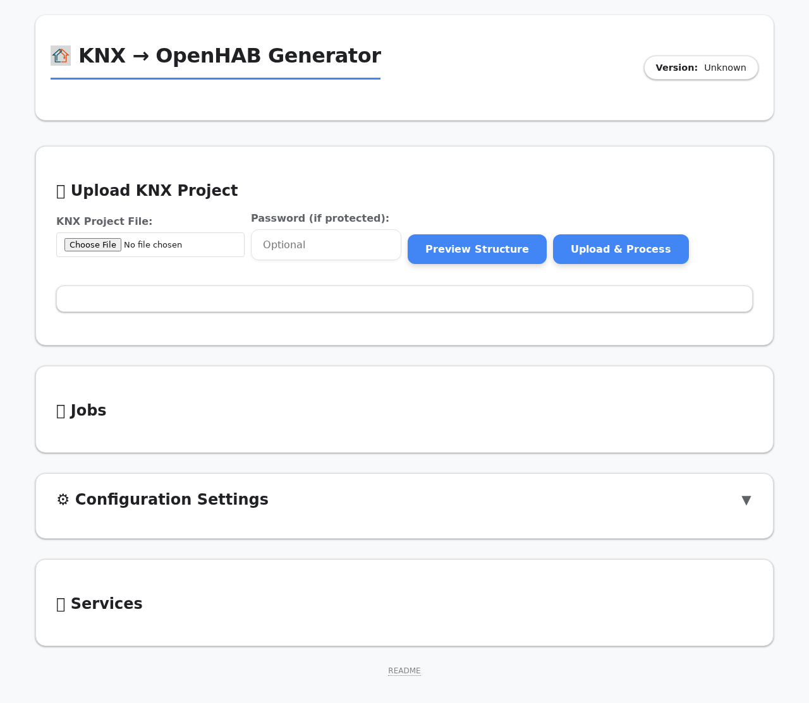
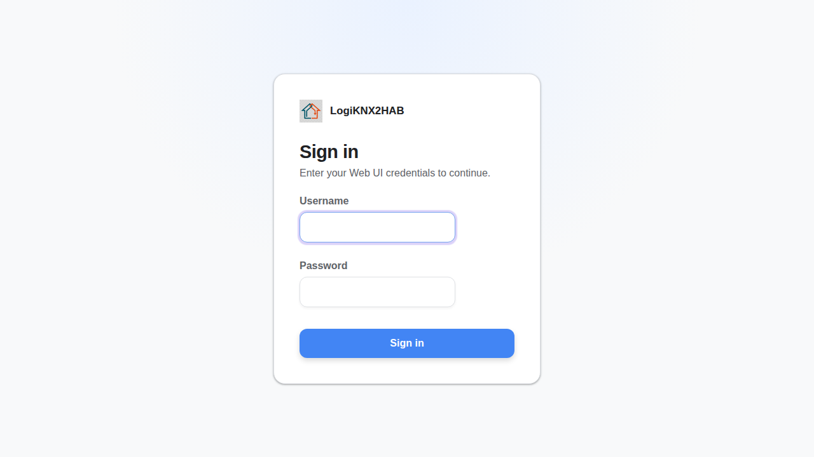
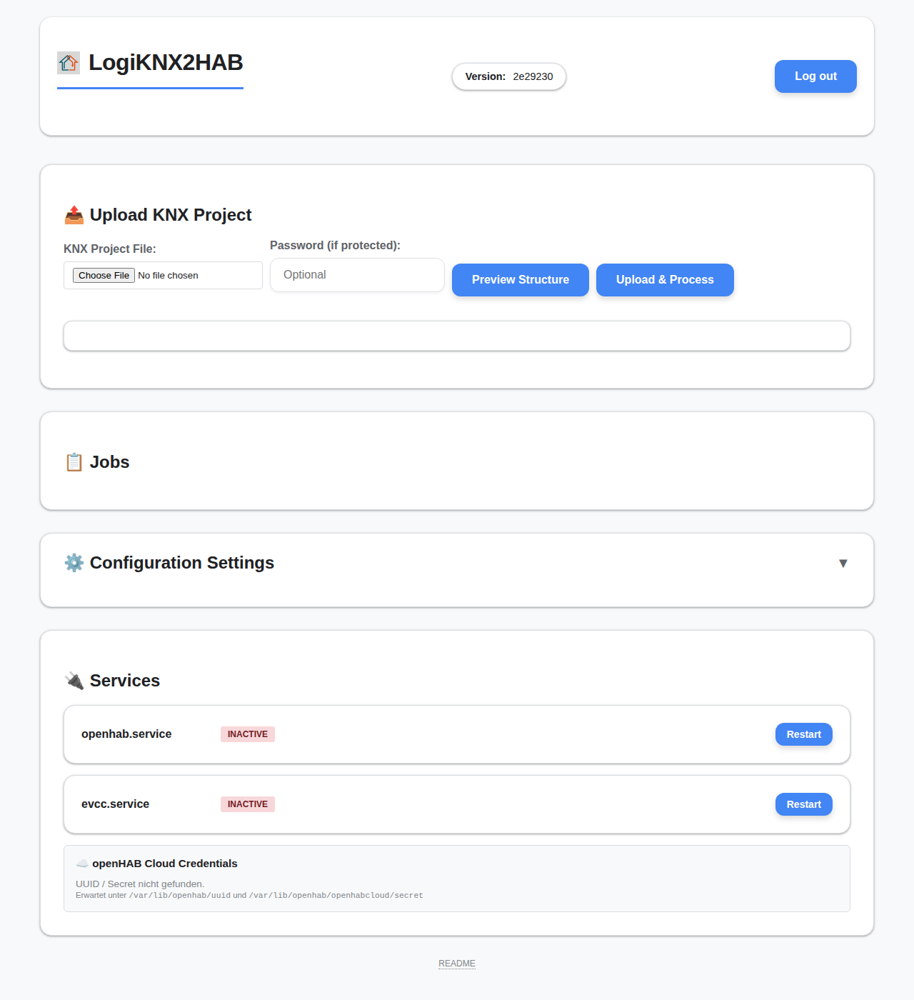
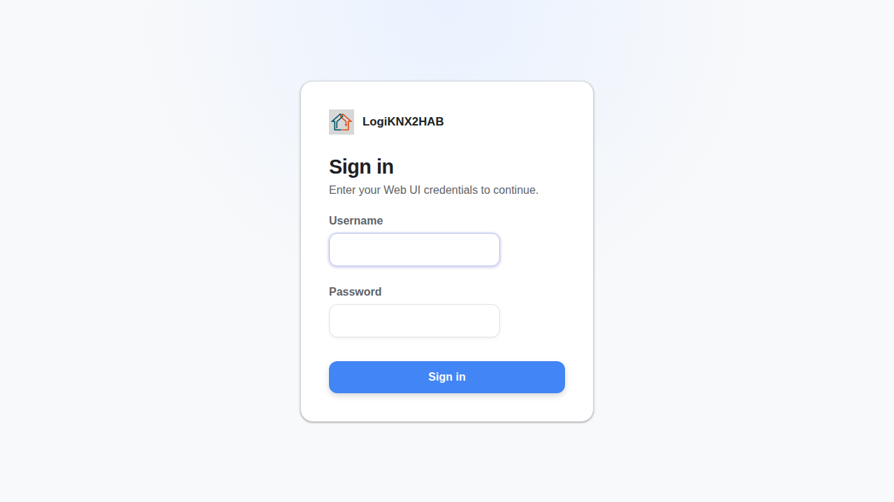
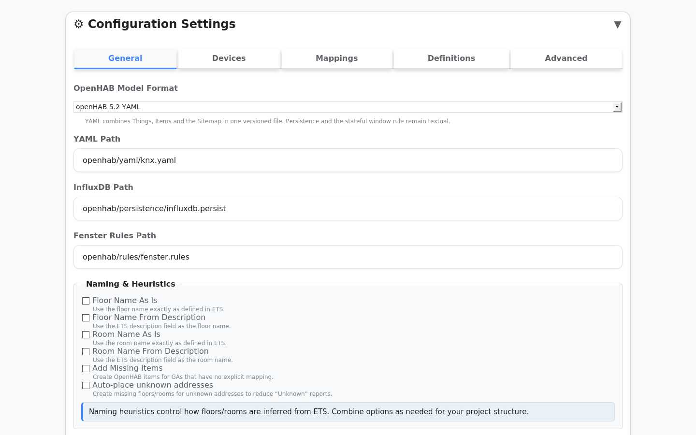
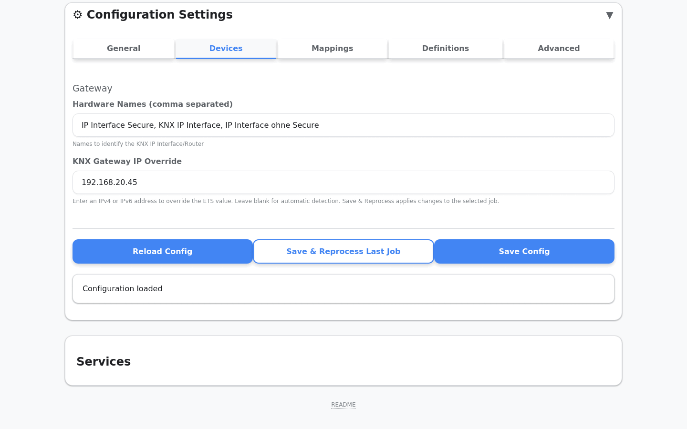
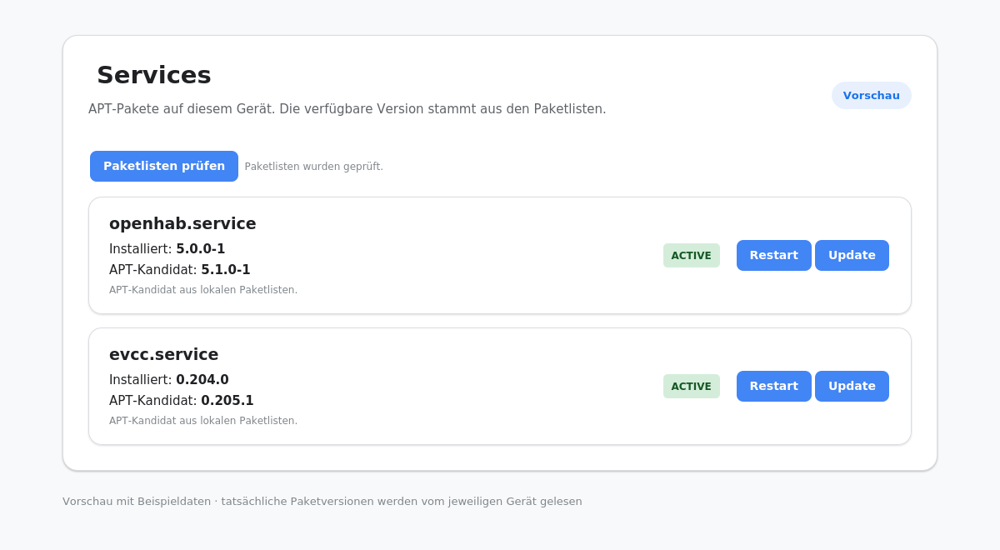

# Feature Upgrade – integrierter Stand der offenen PRs

**Branch:** `developer/feature-upgrade`  
**Dokumentationsstand:** 23.10.2026  
**Ausgangsbasis:** `main` (`f092abd`)  
**Umfang:** Die elf am 23.10.2026 offenen PRs #33, #35, #37, #39, #42–#48 sind auf diesem Integrationsbranch zusammengeführt. `main` ist davon nicht verändert. PR #39 war zum Prüfzeitpunkt ein Draft. Die Aufnahme hier ist eine Integrationsprüfung und kein Release auf `main`.

> [!CAUTION]
> **Nicht auf einer bestehenden produktiven Installation installieren oder `setup.sh` ausführen.** Dieser Branch enthält noch nicht auf einer repräsentativen Bestandsanlage geprüfte Änderungen an Installation, Laufzeitdaten und Systemdiensten. Die Tests auf GitHub belegen die Softwaretests, aber keine sichere Migration oder Wiederherstellung eines realen Geräts. Diese Arbeit hat keine vorhandene Anlage verändert.

**Aktuelle Qualitätsrunde:** Die [README](../README.md) führt jetzt durch den Anwenderablauf. Das Setup beendet sich bei erkannter Bestandsinstallation vor Systemänderungen; ausschließlich für eine wegwerfbare Laborkopie gibt es einen ausdrücklich benannten Override. Im Web-UI zeigt ein Deploy-Dialog die betroffenen Dateien und deren Diff und verlangt eine ausdrückliche Bestätigung. Die Selbstaktualisierung auf `main` ist für Vorschau-Branches gesperrt. Für die neue Oberfläche sind Browserprüfungen und ein Screenshot des Dialogs im CI-Artefakt vorgesehen. Eine reale Bestandsmigration und Wiederherstellung fehlen weiterhin.

Für Anwender reicht diese Seite: Sie zeigt die sichtbaren Änderungen und ihre Bedienung. Technische Prüf- und Installationsdetails stehen in den Admin-/Entwicklerdokumenten am Seitenende.

## Kurz für Anwender

- **Jetzt ist nichts zu tun:** Der Branch ist noch nicht freigegeben. Bestehende Installationen und `main` wurden nicht verändert.
- **Die bisherige Ausgabe bleibt Standard:** Wer kein neues Format auswählt, arbeitet weiter mit den bisherigen `.things`, `.items` und `.sitemap`-Dateien.
- **Neue Funktionen sind optional:** YAML-Ausgabe, feste Gateway-IP und Paketupdates werden nur genutzt, wenn man sie in der Oberfläche auswählt.
- **YAML erzeugt keine parallelen Modell-Dateien:** Bei bewusst gewähltem YAML ersetzt `yaml/knx.yaml` die drei generierten Modell-Dateien. `influxdb.persist` und `fenster.rules` bleiben wie bisher Textdateien.
- **Die vielen neuen Repository-Dateien sind überwiegend Programmcode, Tests und Screenshots:** Sie erzeugen keine zusätzlichen openHAB-Konfigurationsdateien, die Anwender einzeln verwalten müssten.
- **Die geplante Migration legt Systemdaten an getrennten Orten ab:** `/etc/knx_to_openhab`, `/var/lib/knx_to_openhab` und `/var/backups/knx_to_openhab`. Das soll der Installer automatisch verwalten. Auf bestehenden Anlagen ist dieser Schritt noch nicht erprobt und deshalb vorerst gesperrt.

## Vorher und nachher

### Weboberfläche und Anmeldung

**Vorher:** Auf `main` öffnete sich die KNX-Weboberfläche direkt mit dem Dashboard. Es gab keinen Anmeldebildschirm.

**Nachher:** Die Weboberfläche verlangt eine Anmeldung. Nach erfolgreicher Anmeldung erscheint das Dashboard. Nach Ablauf der Sitzung leitet die Oberfläche zurück zur Anmeldung.

Die eingecheckten Nachher-Aufnahmen stammen aus automatisierten Playwright-Läufen. Der integrierte Softwarestand (Commit `3340ad2`) wurde zusätzlich in [GitHub Actions Run #516](https://github.com/diddip21/knx_to_openhab/actions/runs/40021087430) geprüft: 108 UI-Tests bestanden, 2 übersprungen. Der Lauf hat ein [Screenshot-Artefakt](https://github.com/diddip21/knx_to_openhab/actions/runs/40021087430/artifacts/12529744512) mit drei Dateien erzeugt (abrufbar bis 21.01.2027). Die Bilder zeigen synthetische Testdaten. Es wurde kein Video erzeugt; Playwright behält Videos nur bei fehlgeschlagenen Tests.

### Vorher-/Nachher-Übersicht der sichtbaren Funktionen

| Bereich | Vorher auf `main` | Nachher auf `developer/feature-upgrade` | Bildnachweis |
|---|---|---|---|
| Anmeldung | Das Dashboard war direkt und ohne Anmeldung erreichbar. | Login, geschützte Sitzung und Rückleitung zur Anmeldung nach Sitzungsablauf. | Vorher- und Nachher-Aufnahmen oben. |
| Ausgabeformat | Der Generator bot nur die bisherige Textausgabe. | In den erweiterten Einstellungen ist zusätzlich openHAB-5.2-YAML auswählbar; `legacy` bleibt Standard. | [YAML-Einstellung](screenshots/issue-38-yaml-settings.png) und [Beispielausgabe](screenshots/issue-38-generated-yaml.png). |
| KNX-Gateway | Die Adresse kam aus der ETS-Projekterkennung. | Eine optionale IPv4- oder IPv6-Adresse kann die erkannte Adresse überschreiben. | [Gateway-Einstellung](screenshots/issue-40-gateway-ip-settings.png) und [generierte KNX-Bridge](screenshots/issue-40-generated-knx-things.png). |
| Paketupdates | Version und Update-Status waren in der Weboberfläche nicht sichtbar. | openHAB- und evcc-Paketversionen, APT-Kandidaten und verfügbare Einzelupdates erscheinen im Bereich Dienste. | [Updates verfügbar](screenshots/issue-41-updates-available.png) und [evcc ohne APT-Paket](screenshots/issue-41-no-apt-package.png). |

Die Einstellungs- und Ausgabebilder für YAML, Gateway-IP und Paketupdates stammen aus den automatisierten PR-Läufen mit Beispieldaten. Für diese drei Bereiche gibt es im Repository keine authentische Aufnahme der alten `main`-Oberfläche. Der Vorher-Zustand ist daher als Funktionsvergleich beschrieben; es wird kein altes UI-Bild vorgetäuscht. Die übrigen PRs ändern Sicherheit, Installer, Laufzeitdaten oder Tests und erzeugen keine eigene neue Oberfläche.

### Weitere sichtbare Funktionen

**openHAB-YAML-Ausgabe (PR #39):** Die neue Ausgabeoption ist in den erweiterten Einstellungen sichtbar. Der bisherige Legacy-Renderer bleibt die Voreinstellung.

**KNX-Gateway-IP (PR #42):** Im Gerätebereich kann optional eine feste Gateway-IP eingetragen werden. Ein leeres Feld lässt die ETS-Erkennung unverändert.

**Paketupdates (PR #43):** Im Bereich Dienste erscheinen verfügbare APT-Updates für openHAB und evcc; nicht über APT installierte evcc-Installationen werden als nicht unterstützt angezeigt.

## Änderungen im Alltag

| Funktion | Was man tun muss | Vorgabe / Auswirkung |
|---|---|---|
| Anmeldung ([#48](https://github.com/diddip21/knx_to_openhab/pull/48)) | Mit dem Web-UI-Konto anmelden; abmelden, wenn man fertig ist. | Geschützte Sitzung mit Ablauf. Bei fünf falschen Versuchen greift eine 15-minütige Sperre. |
| openHAB-YAML ([#39](https://github.com/diddip21/knx_to_openhab/pull/39)) | Nur bei openHAB 5.2 unter Einstellungen → Erweitert YAML auswählen. | `legacy` bleibt Standard. Die YAML-Datei ersetzt die drei generierten Modell-Dateien; beide Formate dürfen nicht parallel geladen werden. `influxdb.persist` und `fenster.rules` bleiben Textdateien. Der echte Smoke-Test auf openHAB 5.2 steht noch aus. |
| KNX-Gateway-IP ([#42](https://github.com/diddip21/knx_to_openhab/pull/42)) | Im Geräte-Tab optional eine IPv4- oder IPv6-Adresse eintragen. | Leer lassen behält die ETS-Erkennung bei. Ungültige Adressen werden abgewiesen. |
| openHAB-/evcc-Paketupdates ([#43](https://github.com/diddip21/knx_to_openhab/pull/43)) | Kandidat prüfen und nur das gewünschte APT-Paket einzeln aktualisieren. | Docker- und manuelle Installationen bleiben unberührt. Ein echtes Paketupdate wurde auf keinem Gerät ausgeführt. |

## Änderungen im Hintergrund

Diese PRs fügen keine zusätzlichen Bedienelemente hinzu:

- [#33 Upload-Sicherheit](https://github.com/diddip21/knx_to_openhab/pull/33): Dateitypen, Größen, Archive und Projektpasswörter werden sicherer verarbeitet. Weiterhin `.knxproj`, `.knxprojarchive` oder `.json` hochladen.
- [#35 Browser-Tests](https://github.com/diddip21/knx_to_openhab/pull/35) und [#37 Testbereinigung](https://github.com/diddip21/knx_to_openhab/pull/37): prüfen und pflegen die Qualität; keine Änderung an der Bedienung.
- [#44 Rechtebegrenzung](https://github.com/diddip21/knx_to_openhab/pull/44) und [#45 kontrolliertes Deployment](https://github.com/diddip21/knx_to_openhab/pull/45): Systemaktionen und generierte OpenHAB-Zieldateien werden eingeschränkt; manuell gepflegte Dateien werden beim Deploy und Rollback geschützt.
- [#46 Laufzeitpfade](https://github.com/diddip21/knx_to_openhab/pull/46) und [#47 Passwortablage](https://github.com/diddip21/knx_to_openhab/pull/47): verschieben interne Daten und Zugangsdaten an getrennte Systemorte. Der dafür nötige Installer-Eingriff ist noch nicht auf einer Bestandsanlage erprobt; siehe [Status für bestehende Installationen](#status-für-bestehende-installationen).

## Status für bestehende Installationen

**Es gibt für diesen Branch derzeit keine freigegebene Upgrade-Anleitung.** Die vorige Anleitung hat zu früh zum Ausführen des Setup-Skripts auf installierten Systemen aufgefordert; das war missverständlich und ist korrigiert.

Ein Setup auf einem vorhandenen Gerät würde unter anderem:

- `knxohui.service` sowie den Backup-Aufräumdienst stoppen und später den Webdienst mit neuen systemd-Dateien neu starten;
- Konfiguration, Jobs, Upload-/Staging-Daten und Sicherungen in externe Verzeichnisse migrieren, Pfade umschalten und die alten Jobs-/Backup-Verzeichnisse im Installationsbaum löschen;
- Generator-Konfiguration im Installationsverzeichnis durch die Vorlagenversion ersetzen, nachdem die Runtime-Konfiguration ausgelagert wurde;
- Web-UI-Zugangsdaten in eine externe Secret-Datei überführen und gegebenenfalls ein neues Passwort verlangen;
- bei fehlender ausdrücklicher Terminalbestätigung eine bisherige LAN-Bind-Adresse auf `127.0.0.1` ändern, wodurch Fernzugriff ausfallen kann;
- Dateieigentümer, OpenHAB-Ausgaberechte und die sudoers-Policy auf dem Host ändern.

Das sind absichtliche Upgrade-Änderungen des integrierten Codes, aber keine folgenlose Installation. Ein Backup allein belegt keinen sicheren Rollback. Vor einer Freigabe fehlen eine Probe mit einer Kopie repräsentativer Bestandsdaten, ein geprüfter Wiederherstellungslauf, eine klare Vorab-Anzeige der Änderungen sowie ein dokumentierter Abbruch-/Rollback-Pfad. Bis diese Nachweise vorliegen, den Branch nur zur Prüfung verwenden und nicht auf produktiven Bestandsgeräten installieren oder dessen Setup-/Migrationsskripte ausführen.

Das Setup stoppt jetzt bei einer erkannten Bestandsinstallation vor Änderungen. Die genannten Schritte beschreiben ausschließlich den noch nicht freigegebenen Migrationspfad einer ausdrücklich autorisierten Laborkopie; sie wurden auf keinem produktiven Gerät ausgeführt.

Die bisherigen Anlagen wurden im Rahmen dieser Integration nicht angesprochen oder verändert. `main` ist unverändert; der Branch selbst ändert keine Installation, solange sein Code nicht auf einem Gerät ausgeführt wird.

## Dokumentation für Betrieb und Entwicklung

- [Benutzerhandbuch](USER_GUIDE.md): Einstellungen, Login, YAML-Ausgabe, Gateway-IP und Zugriff.
- [Produktionsleitfaden](PRODUCTION_GUIDE.md): Installation, Datenmigration, Secrets, Netzwerkzugriff, Dateirechte und Backup.
- [Entwicklerleitfaden](DEVELOPER_GUIDE.md): Architektur, lokale Pfade, Tests und Änderungen.
- [Web-UI-Entwicklerhinweise](../web_ui/README.md): API, Runtime-Konfiguration, UI und Browser-Tests.
- [Upload-Sicherheit](SECURITY_UPLOAD.md): unterstützte Uploads, Limits und Schutzmechanismen.
- [Integrations-Testbericht](FEATURE_UPGRADE_TESTS.md): Branch-Prüfung, Konfliktlösungen und Testergebnisse.

## Noch offene Betriebsnachweise

Die CI prüft Unit-/Integrationstests, statische Prüfungen und Browserabläufe. Vor einer späteren Freigabe auf `main` sind zusätzlich die in der PR-Dokumentation benannten realen Systemprüfungen erforderlich: YAML-Smoke-Test auf openHAB 5.2, Paketupdate auf einem geeigneten Testgerät und Upgrade-/Datenmigration auf einer repräsentativen Bestandsinstallation.
