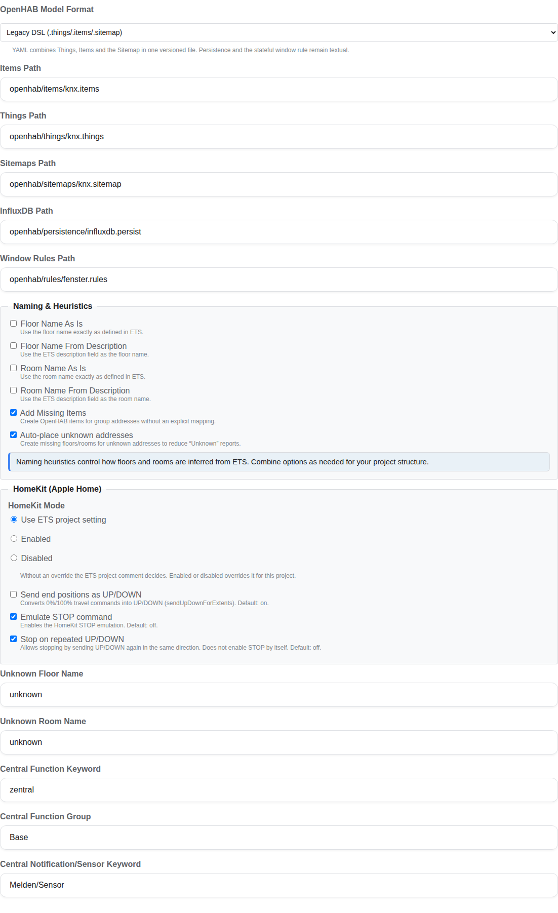
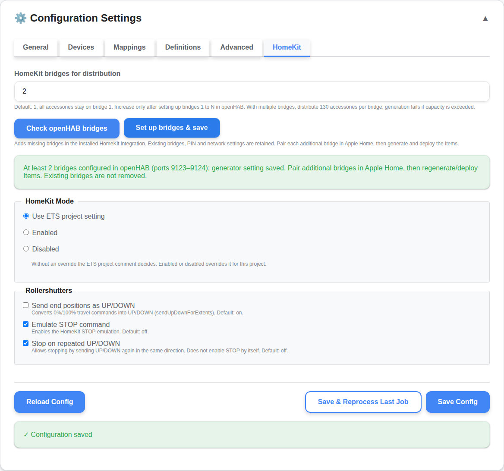

# HomeKit-Bridge-Zuordnung (Issue #113)

## Entscheidung vor der Umsetzung

Ausgangspunkt ist `dev` bei `4c0a26d`; frühere Issue-Kommentare sind keine
Grundlage dieses Plans. Die Korrektur umfasst Generator, Legacy-/YAML-Ausgabe,
Konfiguration, API, HomeKit-Einstellungen und Regressionstests.

- Fehlende Konfiguration und `general.homekit_bridge_count = 1` ordnen alle
  Accessories Bridge 1 zu. Auch nach 130 Accessories wird keine weitere Bridge
  vorausgesetzt. Oberhalb dieser Planungsschwelle erscheint eine Warnung.
- Eine ganze JSON-Zahl größer als 1 bestätigt, dass die Bridges 1 bis N bereits
  eingerichtet sind. Nur dann wird nach jeweils 130 Accessories weiterverteilt.
  Bei mehr als N × 130 Accessories scheitert die Generierung vor Export/Deployment.
  Ungültige Werte werden beim Speichern und im Generator zurückgewiesen.
- Gezählt werden eigenständige HomeKit-Items und HomeKit-Root-Gruppen, jeweils
  einmal. Characteristics einer solchen Gruppe zählen nicht zusätzlich und
  tragen kein eigenes `instance`. Die vorhandene Geräteerkennung in den drei
  Durchläufen bleibt erhalten: zuerst Zuordnungen zusammengehöriger Adressen,
  anschließend noch nicht verbrauchte Einzeladressen. Die Bridge-Zuordnung
  erfolgt erst beim Erzeugen eines Accessories, nicht beim Auflösen seiner GAs.
- Legacy verwendet das unquotierte `instance=2`. Im strukturierten Modell und
  YAML wird ausschließlich der unquotierte positive Integer `homekit.instance`
  in eine Zahl umgewandelt. Andere Schlüssel und Typen bleiben erhalten.
- Tests prüfen den bisherigen Fehler, Bridge 2, komplexe Accessories, 129/130/131,
  Kapazitätsüberschreitung, ungültige Werte und das Erhalten benachbarter Optionen.
  Golden-Dateien werden regeneriert; Core-, UI-, Format-/Lint- und Diff-Prüfungen
  werden ausgeführt und ihre Grenzen dokumentiert.

## Historischer Befund und Kompatibilität

Der [Commit d6a0bc8 vom 22.07.2024](https://github.com/diddip21/knx_to_openhab/commit/d6a0bc81b187c7f41e91df2a8d6a19fb676d991b)
führte die Verteilung mit `instance` ein. [b53e2e4 vom 30.07.2024](https://github.com/diddip21/knx_to_openhab/commit/b53e2e478b16139dc8034552194d48d15c57a7ee)
änderte den Schlüssel zu `Instance`. Gemeint war eine Bridge, keine Accessory-ID.
Schon [openHAB 4.2.0](https://github.com/openhab/openhab-addons/blob/4.2.0/bundles/org.openhab.io.homekit/src/main/java/org/openhab/io/homekit/internal/HomekitTaggedItem.java)
definiert den Schlüssel kleingeschrieben. Der [Selektor in 5.2.4](https://github.com/openhab/openhab-addons/blob/5.2.4/bundles/org.openhab.io.homekit/src/main/java/org/openhab/io/homekit/internal/HomekitChangeListener.java)
liest diesen Schlüssel als Java `Number`; fehlende oder anders typisierte Werte
fallen auf Bridge 1 zurück. Er überspringt untergeordnete Characteristics bei
der Root-Erzeugung. Die gezielte Korrektur gilt für beide Exportformate und
verändert weder andere HomeKit-Schlüssel noch KNX-Kanäle oder Template-Wrapper.

## Bedienung und Migration

Im HomeKit-Tab bleibt die Bridge-Anzahl zunächst 1. Für die CLI gilt dieselbe
Vorgabe bei fehlendem Schlüssel. Beispiel für zwei **bereits konfigurierte**
Bridges im bestehenden `general`-Objekt der Generator-Konfiguration:

```json
"homekit_bridge_count": 2
```

Das reine Speichern der Zahl erzeugt keine Bridges. Die zusätzliche Aktion
**Bridges einrichten & speichern** ergänzt sie über die lokale openHAB-API und
speichert danach die Generator-Einstellung. Anschließend jede zusätzliche
Bridge in Apple Home koppeln, Items neu generieren, Vorschau prüfen und deployen. Die
[versionierte Add-on-Anleitung](https://github.com/openhab/openhab-addons/blob/5.2.4/bundles/org.openhab.io.homekit/README.md#multiple-instances)
beschreibt die Einrichtung; eine Zuweisung an eine fehlende Bridge ist unsichtbar.
Die dort genannte Protokollgrenze beträgt 149 Geräte neben der Bridge. Die
130er-Schwelle hier ist eine konservative Verteilungsregel, keine Erhöhung
dieser Grenze. Weitere, manuell angelegte Accessories sind darin nicht enthalten.

Bestehende Ein-Bridge-Konfigurationen brauchen keine Migration des Schlüssels.
Neu generieren, Ausgabe kontrollieren und über den üblichen gesicherten
Deployment-Weg übernehmen. Vorhandene manuelle Metadaten werden nicht repariert.
Bei großen Ein-Bridge-Projekten war die bisherige Verteilung wegen `Instance`
wirkungslos; die neue Vorgabe hält diese Zuordnung aufrecht. Sie löst keine
bereits vorhandene Überbelegung der realen Bridge.

Bei expliziter Verteilung können sich Zuordnungen ändern, wenn Accessories
hinzukommen/entfallen oder sich die Generierungsreihenfolge ändert. Vor dem
Deployment den Export prüfen; Apple-Home-Räume und Automationen nachprüfen.
Keine automatische Pairing-Löschung. Die Einrichtungsaktion ändert ausschließlich
die Anzahl der Instanzen in der Add-on-Konfiguration.
Endlagen-, Lamellen- und Stop-Optionen bleiben eigenständig erhalten.

## Zusätzliche Bridges direkt einrichten

Die HomeKit-Systemintegration muss bereits in openHAB installiert sein.
**openHAB-Bridges prüfen** zeigt die konfigurierte Anzahl und den Portbereich.
**Bridges einrichten & speichern** liest diese Anzahl, erhöht bei Bedarf nur
`instances` und liest die Einstellung anschließend erneut zur Bestätigung.
Ist bereits eine höhere Anzahl vorhanden, bleibt sie erhalten. Ein vollständiger
Neustart wird nicht ausgelöst. Das Add-on startet zusätzliche Instanzen selbst;
die Sichtbarkeit über mDNS und in Apple Home ist damit noch nicht nachgewiesen.

Die Aktion verwendet einen partiellen `PUT` auf
`/rest/services/org.openhab.homekit/config` mit ausschließlich `{"instances": N}`.
Die [openHAB-REST-Implementierung](https://github.com/openhab/openhab-core/blob/4.2.0/bundles/org.openhab.core.io.rest.core/src/main/java/org/openhab/core/io/rest/core/config/ConfigurationService.java)
ergänzt solche Parameter ohne die übrige Konfiguration zu ersetzen.
PIN, Name, Netzwerkadresse, Setup-ID und weitere Optionen werden weder
zurückgeschrieben noch in der Web UI ausgegeben oder in Backups kopiert.
Der [HomeKit-Lebenszyklus](https://github.com/openhab/openhab-addons/blob/5.2.4/bundles/org.openhab.io.homekit/src/main/java/org/openhab/io/homekit/internal/HomekitImpl.java)
zeigt auch, warum keine automatische Reduktion erfolgt: Entfernte Instanzen
können ihren Pairing-Speicher verlieren.

Die Einrichtung ist ein eigener Schritt vor der Dateivorschau und dem normalen
Deployment. Ein Rollback von Items entfernt keine Bridges. Scheitert nach der
Einrichtung das Speichern der Generator-Konfiguration, meldet die UI diesen
Teilerfolg; die neu eingerichteten Bridges bleiben erhalten. Speichern erneut
versuchen. Nach einer Zeitüberschreitung zuerst den Status prüfen, da die Änderung
bereits angekommen sein könnte. Die App führt keine blinde Wiederholung und
keine automatische Rücknahme der Bridge-Anzahl aus. Während der Einrichtung
keine parallelen manuellen Änderungen an der HomeKit-Anzahl vornehmen; die
openHAB-API bietet hier keinen atomaren Vergleich mit dem zuvor gelesenen Wert.

Bei einer expliziten `instances`-Angabe in `services/*.cfg` oder einem exklusiven
HomeKit-`pid:`-Abschnitt blockiert die App eine Erhöhung über REST. Diese Dateien
bleiben unverändert, damit eine spätere Dateieinlesung die REST-Einstellung nicht
unbemerkt zurücksetzt. Dort gezielt `org.openhab.homekit:instances=N` anpassen
und anschließend erneut prüfen. Bei unerreichbarem openHAB, fehlenden Rechten,
ungültiger Antwort oder fehlender Bestätigung wird kein Erfolg behauptet.

### API-Zugang auf dem openHAB-Rechner

Standardziel ist `http://127.0.0.1:8080/rest`. Für einen anderen lokalen Port kann
der Dienstadministrator `KNXOH_OPENHAB_REST_URL` über einen systemd-Drop-in
setzen; zugelassen sind ausschließlich Loopback-Adressen (`127.0.0.1`, `::1`,
`localhost`) mit HTTP(S). Keine Weiterleitungen oder Umgebungs-Proxys.

Falls openHAB Administratorrechte verlangt, in dessen Main-UI-Profil einen
Administrator-API-Token anlegen. Den Token als einzelne Zeile in
`$KNXOH_CONFIG_DIR/openhab_api_token` hinterlegen, bei Standardinstallation
`/etc/knx_to_openhab/openhab_api_token`, mit Eigentümer `root:knxohui` und Modus
`0640`. Der Dienst muss die Datei lesen können. In der lokalen Entwicklungsumgebung
liegt sie im konfigurierten Backend-Konfigurationsverzeichnis. Keine Tokens in
`config.json`, Generator-Einstellungen, URLs oder Screenshots eintragen.
Die Authentifizierung folgt der [offiziellen REST-Anleitung](https://www.openhab.org/docs/configuration/restdocs.html#authentication)
mit API-Token als Basic-Benutzername und leerem Passwort. Die vorhandene
Zugriffskontrolle der Web UI schützt auch diese Einrichtungsaktion.

Für die CLI unter denselben Dienst-/Pfadumgebungsvariablen:

```sh
python -m web_ui.backend.homekit_bridges             # Status lesen
python -m web_ui.backend.homekit_bridges --count 2   # mindestens zwei Bridges
```

Danach `general.homekit_bridge_count` auf die gewünschte Aufteilungszahl setzen
und die normale Generierung starten. Der CLI-Einrichtungsschritt ändert keine
Generator-Konfiguration und keine manuell gepflegte openHAB-Datei.

## Oberfläche

Der Screenshot zeigt den echten Flask-Testserver nach Speichern und Neuladen:
zwei ausdrücklich konfigurierte Bridges, Endlagen aus und beide Stop-Optionen an.
Er verwendet isolierte Testkonfiguration ohne persönliche Projektdaten.



Die zweite Ansicht zeigt die bestätigte Einrichtung mit dem HTTP-Adapter im
Browser-Test emuliert. Die Generator-Einstellung wird am echten Flask-Server
gespeichert. Das ist kein Nachweis für reale Bridges in Apple Home.



## Noch offene Laufzeitprüfung

Quellenanalyse und Exporttests belegen keine erfolgreiche reale Bridge-Zuordnung.
Mit installierter openHAB-/Add-on-Version dokumentieren: einfache Accessories
und eine komplexe Root-Gruppe auf Bridge 2, Sichtbarkeit in Apple Home und
unveränderte Characteristics/Stop-/Endlagenfunktion. Mit einer Bridge außerdem
prüfen, dass die Korrektur keine zusätzliche Instanz voraussetzt. Diese Prüfung
bleibt offen, bis echte Laufzeitbelege vorliegen; Issue #113 bleibt entsprechend offen.
