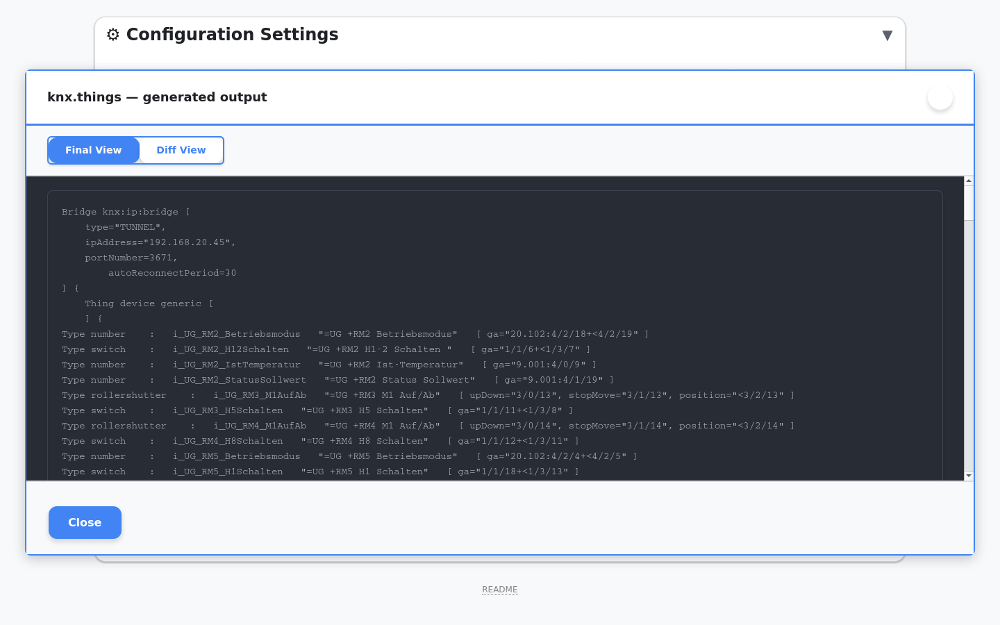

# Issue #40: KNX gateway IP override

These screenshots show the updated Devices settings and the generated `knx.things` output. The sample address is `192.168.20.45`.

## Devices settings

The optional override is saved with the gateway settings. Leave it blank to keep automatic detection from the ETS project.

## Generated output

The staged file preview shows the override applied to the KNX bridge while the rest of the generated configuration remains present.

