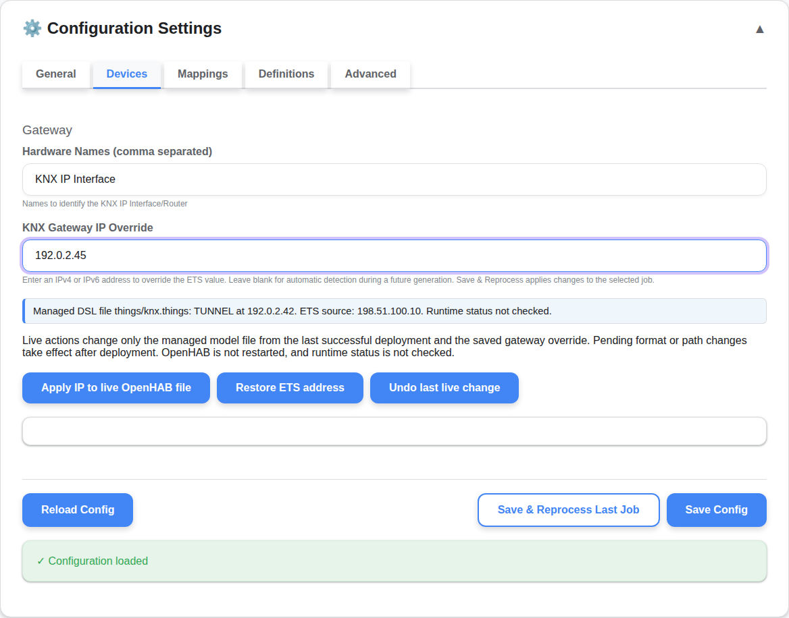
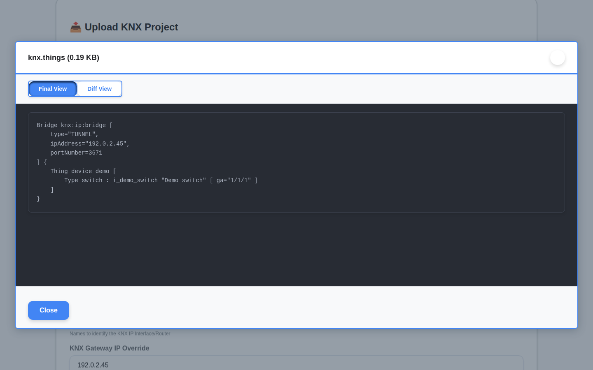

# Issue #40: KNX gateway IP override

These screenshots show the updated Devices settings and a `knx.things` file preview. They were captured from the Web UI with synthetic example data: the documentation IP address `192.0.2.45` and group address `1/1/1`.

## Devices settings

The optional override is saved with the gateway settings. Leave it blank to keep automatic detection from the ETS project.

## Generated output

The file preview shows how the override appears in the KNX bridge. Its displayed Thing and group address are synthetic examples, not output from an ETS project.

