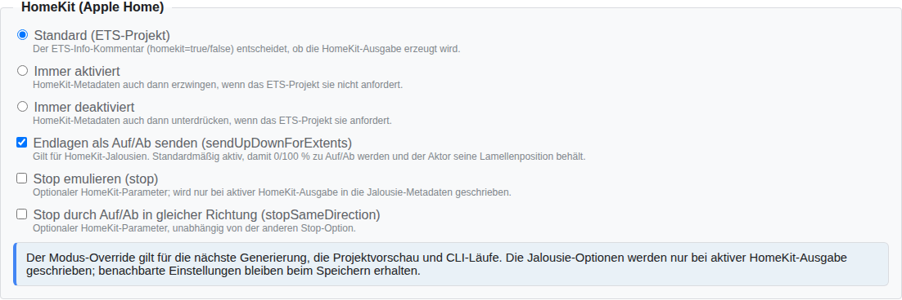
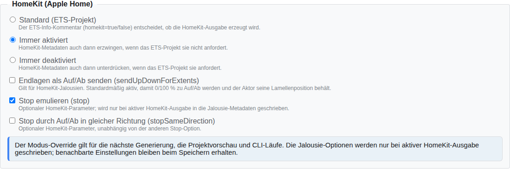
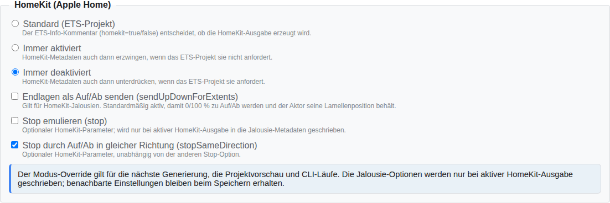

# HomeKit-Abnahme: Einstellungen und Ausgabe

Stand: 16.11.2026, Issue #89 / PR #108. Die Softwareprüfung ist von der
noch fehlenden Prüfung am realen KNX-Aktor getrennt.

Bildquelle: [CI-Lauf 43959494033](https://github.com/diddip21/knx_to_openhab/actions/runs/43959494033),
Commit `5f1f0f5`. Alle drei echten Roundtrip-Fälle bestanden; der gesamte
Browserlauf meldete 218 bestandene Tests und einen wegen deaktivierter
Authentifizierung des allgemeinen Testservers übersprungenen Login-Fall.

## Echte UI mit Speichern und Neuladen

Die Bilder stammen aus der echten Flask-Anwendung mit temporären,
synthetischen Daten. Der Test verwendet die unveränderten Konfigurationsrouten:
UI-POST, gespeicherte JSON-Datei, erneutes API-GET und kompletter Seitenreload.
Nur die externe Release-Abfrage wird simuliert. Der benachbarte Wert
`central_function_keyword=acceptance-central` muss erhalten bleiben.

| Ansicht nach Reload | HomeKit-Override | Endlagen als Auf/Ab | Stop | Gleiche Richtung |
| --- | --- | --- | --- | --- |
| Standard / ETS | Key fehlt | true | false | false |
| Immer aktiviert | true | false | true | false |
| Immer deaktiviert | false | false | false | true |







Die deaktivierte Ansicht belegt die gespeicherten Einstellungen, keine aktive
HomeKit-Ausgabe. Bei deaktiviertem HomeKit wird keine HomeKit-Metadatenoption
ausgegeben. Die maschinenlesbaren Roundtrip-Belege liegen zusammen mit den
Originalbildern im CI-Artefakt `ui-screenshots-and-reports` unter `homekit/`.

## Legacy und YAML

Der Test `test_exported_legacy_and_yaml_have_equivalent_homekit_metadata`
exportiert beide Dateiformate tatsächlich und liest YAML unabhängig mit
PyYAML ein. Equipment-, Positions- und Lamellen-Metadaten werden mit der
Legacy-Ausgabe verglichen. Abgedeckt sind fehlender Key, explizites false,
beide Stop-Optionen sowie HomeKit aus. `Instance` und die beiden
Lamellen-Characteristics bleiben erhalten.

Beispiel aus dem synthetischen Mini-Projekt bei fehlendem Endlagen-Key:

```text
Group   equipment_i_EG_RM1_JalousieJalousieAufAb   "RM1 Jalousie"  <rollershutter>  (map1_1)   ["Blinds"] { homekit = "WindowCovering" [Instance=1, sendUpDownForExtents="true"] }
```

Der zugehörige HomeKit-Metadatenabschnitt der YAML-Ausgabe:

```yaml
metadata:
  homekit:
    value: "WindowCovering"
    config:
      Instance: "1"
      sendUpDownForExtents: "true"
```

Die 30 fokussierten Generator-/Konfigurationstests bestehen lokal.
Charne, UploadJson und Mini wurden neu erzeugt; ihre Golden-Ausgaben bleiben
inhaltlich unverändert. Maßgeblich für die vollständige Core-/UI-Abnahme
bleibt die CI des aktuellen PR-Heads.

## Quellencheck: openHAB 5.2.4

Die [offizielle HomeKit-Dokumentation](https://www.openhab.org/addons/integrations/homekit/#window-covering-blinds-window-door)
beschreibt Endlagenbefehle und die umgekehrte Prozentzuordnung zwischen
HomeKit und openHAB. Die geprüfte Implementierung ist hier bewusst auf
den Tag **5.2.4** festgelegt; die installierte Version des Owners ist noch
nicht bekannt.

- [AbstractHomekitPositionAccessoryImpl](https://github.com/openhab/openhab-addons/blob/5.2.4/bundles/org.openhab.io.homekit/src/main/java/org/openhab/io/homekit/internal/accessories/AbstractHomekitPositionAccessoryImpl.java#L66)
  liest Endlagen-/Stop-Optionen über die Accessory-Konfiguration und wandelt
  Endlagen nach der Invertierung in UP/DOWN um. Zwischenwerte bleiben Prozentbefehle.
- [AbstractHomekitAccessoryImpl](https://github.com/openhab/openhab-addons/blob/5.2.4/bundles/org.openhab.io.homekit/src/main/java/org/openhab/io/homekit/internal/accessories/AbstractHomekitAccessoryImpl.java#L330)
  ordnet diese Konfiguration dem Root-Accessory zu, bei gruppierten Accessories
  also der Equipment-Gruppe. Die Endlagenoption gehört hier nicht an das
  Positions- oder Lamellen-Characteristic-Item.
- [HomekitTaggedItem](https://github.com/openhab/openhab-addons/blob/5.2.4/bundles/org.openhab.io.homekit/src/main/java/org/openhab/io/homekit/internal/HomekitTaggedItem.java#L401)
  akzeptiert sowohl Booleans als auch den String `"true"`; die erzeugten
  Legacy-/YAML-Werte sind damit für diesen Quellstand lesbar.
- `stopSameDirection` bestimmt die Befehlsart der Stop-Emulation. Die Schlüssel
  bleiben unabhängig speicherbar; der Schalter allein aktiviert die
  Stop-Emulation im Add-on nicht.

## Hardware-Abnahme bleibt offen

Der Owner bestätigte am 16.11.2026: **Noch kein Hardwaretest vorhanden.**
Deshalb bleiben PR #108 als Draft und der HomeKit-Merge gesperrt.

Für den späteren Beleg sind openHAB-/HomeKit-Version, Aktormodell und relevante
Parameter sowie eine anonymisierte Befehlsfolge zu erfassen. Zu prüfen sind
beide Endlagen einschließlich Lamellenverhalten, eine Zwischenposition,
separate Lamellensteuerung, Stop und die Rückkehr zur vorherigen Konfiguration.
HomeKit-/openHAB-Invertierung und die tatsächlich verwendete Stop-Kombination
müssen dabei angegeben werden. Quellencheck, Unit-Tests und Screenshots
ersetzen den Nachweis am betroffenen Gerät nicht.
