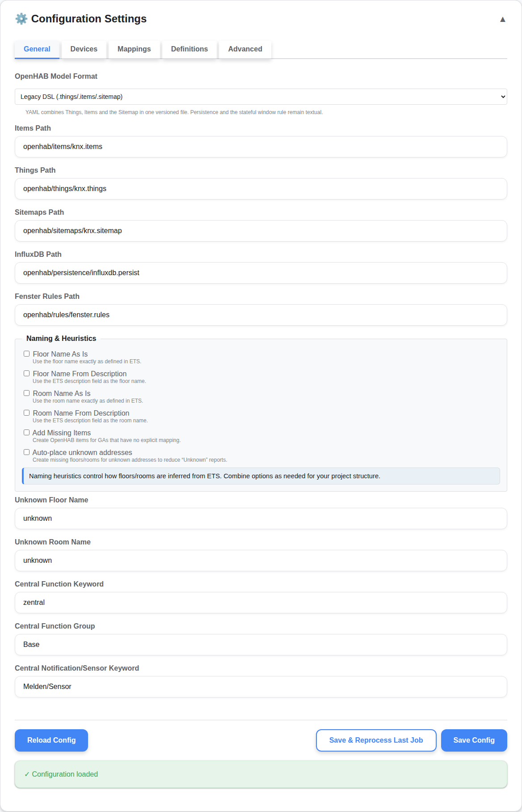
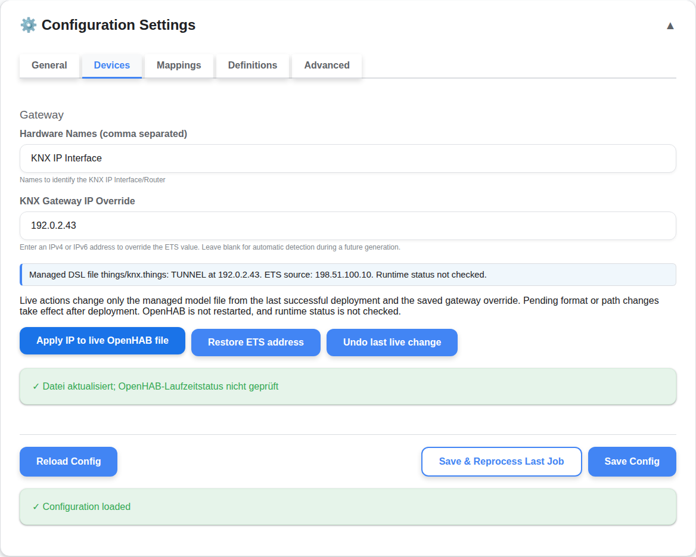

# KNX Things format and live gateway IP

These screenshots show the `output_format` selector and the result of applying the documentation-only sample address `192.0.2.43`; `198.51.100.10` is the sample ETS source address. The `192.0.2.0/24` and `198.51.100.0/24` ranges are reserved for documentation. The live target is the managed file from the last successful deployment, shown relative to the OpenHAB root; pending format/path selections do not relabel it. The success state confirms only that the managed file was updated, not that OpenHAB reloaded it or that the bridge is online.

## Output format settings

The General tab has one `output_format` selector. Legacy DSL remains the default; YAML is the complete native openHAB 5.2 model containing Things, Items, and Sitemaps. The screenshot also shows the separate paths retained for legacy output.

## Live IP applied

The Devices tab shows the relative deployed target `things/knx.things`, Apply, Restore ETS, and Undo controls. It shows the sample address after the file-only update, with Undo available and runtime status explicitly unchecked. YAML live actions require a known OpenHAB 5.2-or-newer version; YAML destinations must be provisioned before deployment. Undo is guarded against a new deployment, changes to the deployed target, or edits to the managed file.

