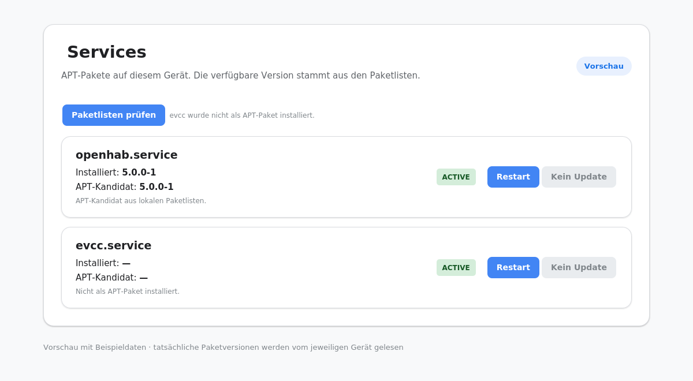

# KNX → OpenHAB Web UI

For the complete user-visible overview of the integrated feature set, compatibility notes,
upgrade status and before/after screenshots, see [`docs/FEATURE_UPGRADE.md`](../docs/FEATURE_UPGRADE.md).

Lightweight Flask web interface for `knxproject_to_openhab.py`. Upload KNX project files, preview the building structure, generate OpenHAB configuration, review diffs, and deploy — all from a browser.

## Start safely

This integration branch is only for development and disposable test systems. Its setup script blocks existing installations. For local development use the instructions below. For a fresh `main` installation see the [Production Guide](../docs/PRODUCTION_GUIDE.md). New installations listen on `127.0.0.1:8085` by default; remote access uses an SSH tunnel or an explicitly configured LAN bind / HTTPS proxy.

The self-update action is limited to a checkout of `main`. A preview checkout cannot automatically switch to `main`; update it manually only in a disposable test environment. This is separate from the APT package actions for openHAB and evcc.

## Architecture

```
web_ui/
├── backend/
│   ├── app.py              # Flask routes, auth, SSE
│   ├── jobs.py             # Job queue, staging, deploy, backup
│   ├── storage.py          # JSON persistence, atomic writes
│   ├── updater.py          # Git-based self-update via GitHub API
│   ├── service_manager.py  # systemd service control
│   ├── config.json         # Local development defaults only
│   └── gunicorn_conf.py    # Production gunicorn config
├── templates/
│   └── index.html          # Single-page application
├── static/
│   ├── app.js              # Frontend logic, SSE, diff viewer
│   └── style.css           # CSS with custom properties
└── api_schema.json         # API documentation
```

## Local Development

```bash
# Clone and set up
git clone https://github.com/diddip21/knx_to_openhab.git
cd knx_to_openhab
python -m venv .venv
source .venv/bin/activate  # Windows: .venv\Scripts\Activate.ps1
pip install -r requirements.txt

# Start local browser tests without production credentials
export FLASK_ENV=testing
flask --app web_ui.backend.app:app run --debug
# → http://localhost:5000
```

## API Endpoints

| Method | Path | Description |
|--------|------|-------------|
| POST | `/api/upload` | Upload `.knxproj` file, create job |
| GET | `/api/jobs` | List all jobs |
| GET | `/api/job/<id>` | Get job details |
| GET | `/api/job/<id>/events` | SSE live log stream |
| GET | `/api/job/<id>/diff` | Diff stats for job files |
| POST | `/api/job/<id>/rerun` | Re-run job with same input |
| POST | `/api/job/<id>/deploy` | Deploy staged files to live OpenHAB |
| POST | `/api/job/<id>/rollback` | Restore from backup |
| DELETE | `/api/job/<id>` | Delete job |
| GET | `/api/job/<id>/preview` | Building structure preview |
| GET | `/api/file/preview` | Read file content (live/staged/backup) |
| GET | `/api/config` | Read main config.json |
| POST | `/api/config` | Write main config.json |
| GET | `/api/config/schema` | Return config JSON Schema |
| POST | `/api/project/preview` | Parse knxproj, return building tree |
| POST | `/api/service/restart` | Restart a systemd service |
| GET | `/api/service/<name>/status` | Check service status |
| GET | `/api/version` | Current git version info |
| GET | `/api/version/check` | Check GitHub for updates |
| POST | `/api/version/update` | Trigger self-update |
| GET | `/api/service/<openhab|evcc>/version` | Installed package and APT candidate |
| POST | `/api/service/updates/<refresh|openhab|evcc>` | Refresh package lists or update one package |
| GET | `/api/status` | Health check (no auth) |

Full schema: see `api_schema.json`.

### openHAB and evcc package updates

The Services panel compares the installed Debian package with the candidate from the local APT
package lists. Use **Paketlisten prüfen** to refresh those lists, then update either package
individually. The update follows the configured APT repository (including an evcc nightly
repository, if configured). Review the upstream release notes before a major upgrade. Manual,
Docker, and other non-APT installations are shown as unsupported; they are never modified.

The update installs the exact APT version shown in the confirmation. If the candidate changes
before installation, it aborts and asks you to check again. The update runs in the background.
The UI reports completion or failure; existing generated
openHAB configuration is not replaced by the Web UI. A personal Web UI password is required.
After upgrading an existing Web UI installation from a version before this feature, run
`cd /opt/knx_to_openhab && sudo bash installer/setup.sh` once from an interactive SSH
terminal. Setup prompts for a new Web UI password when the old installation has only the
shipped default, then installs the root-owned, package-restricted update helper and its
sudoers entries. This step is also performed by `install.sh` on a new installation. The APT candidate can be newer than the version displayed
before refreshing the package lists; the selected package is the only one explicitly upgraded.

Example screens with illustrative versions:




On an installed system, runtime settings live in `/etc/knx_to_openhab/config.json`,
generator rules live in `/var/lib/knx_to_openhab/generator.json`, and the Argon2id UI
password hash is stored in `/etc/knx_to_openhab/secrets.env`. Fresh installs
prompt for a unique password; existing user-chosen passwords are preserved during migration,
while the shipped default requires replacement. Jobs and uploads
live in `/var/lib/knx_to_openhab/jobs`, staging output in
`/var/lib/knx_to_openhab/staging`, and backup archives in
`/var/backups/knx_to_openhab`. The installer migrates existing files before
switching the application to these paths. The tracked `backend/config.json` is
only used for local development and must not be edited to configure production.

## Configuration

Production runtime config in `/etc/knx_to_openhab/config.json`:

```json
{
  "openhab_path": "openhab",
  "jobs_dir": "/var/lib/knx_to_openhab/jobs",
  "staging_dir": "/var/lib/knx_to_openhab/staging",
  "generated_dir": "/var/lib/knx_to_openhab/generated",
  "backups_dir": "/var/backups/knx_to_openhab",
  "bind_host": "127.0.0.1",
  "port": 8085,
  "trusted_proxy_hops": 0,
  "session_max_age_seconds": 43200,
  "auth": {
    "enabled": true,
    "user": "admin"
  },
  "retention": {
    "days": 14,
    "max_backups": 50,
    "max_backups_size_mb": 500
  }
}
```

The default binds only to the local machine. Setup asks before retaining a legacy
LAN-wide bind. To allow direct LAN access, deliberately set `bind_host` to the
device's private interface address and restart the service. For HTTPS, keep the
application on loopback behind a reverse proxy and set `trusted_proxy_hops` to
the exact number of trusted proxies (usually `1`). The proxy must set
`X-Forwarded-Proto`; cookies are marked `Secure` when the request is recognized
as HTTPS. Write API requests require the signed-in session cookie and
`X-CSRF-Token` header.

## Troubleshooting

```bash
# Check if server is running
curl http://localhost:8085/api/status

# View logs
sudo journalctl -u knxohui.service -f

# Restart service
sudo systemctl restart knxohui.service

# Check port
netstat -tulpn | grep 8085
```

Deploy writes only the configured generator outputs (`items`, `things`,
`sitemaps`, `persistence`, `rules`, and optional YAML) plus the three generated
reports. Targets must be existing regular files inside the effective OpenHAB
configuration root. Symlinks and traversal paths are rejected. Rollback
restores those managed files from the selected full-tree backup and leaves
manually maintained files untouched.
